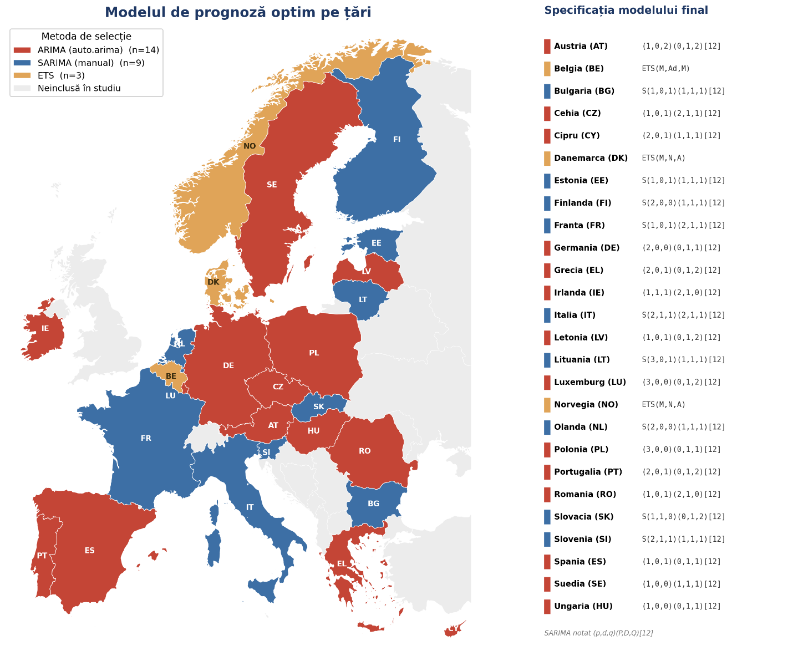
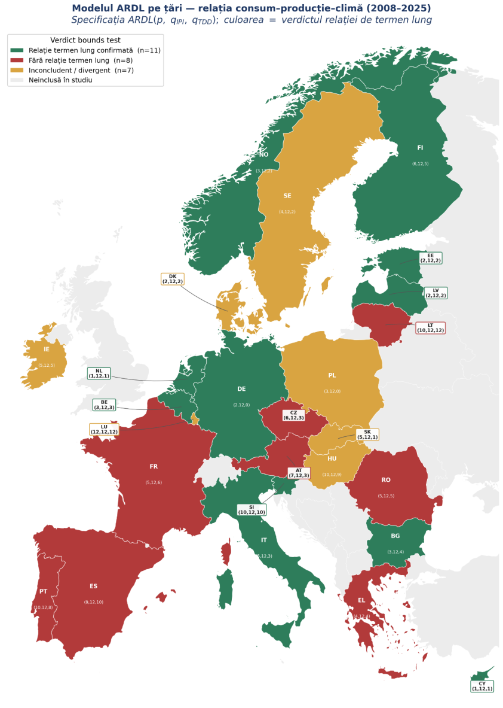
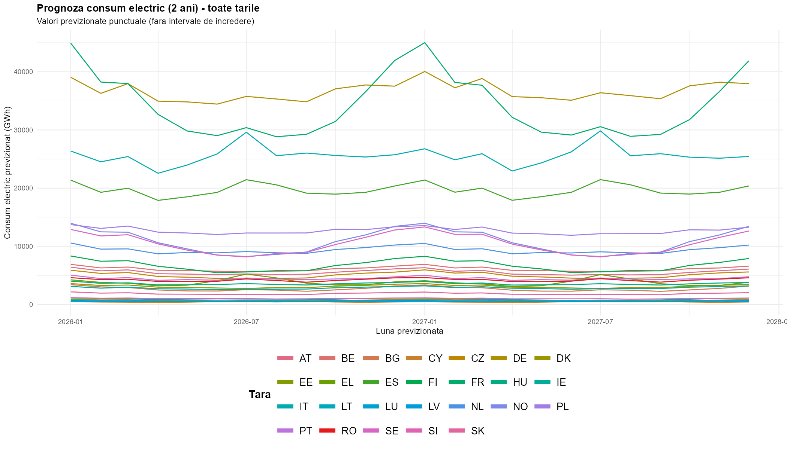

# Analysis and Forecasting of Electricity Consumption in European Countries

Bachelor's thesis project. Bucharest University of Economic Studies (ASE), Faculty of Cybernetics, Statistics and Economic Informatics, Economic Cybernetics, 2026.

The project models and forecasts **monthly electricity consumption in 26 European countries (January 2008 to December 2025)**. It also studies how consumption relates to **industrial production** and **temperature-driven energy demand**. The whole analysis is done in **R**, using open data from **Eurostat**.

**Author:** Tudor-Adrian Boicu · **Supervisor:** Conf. univ. dr. Ionela Cătălina Zamfir

---

## Key results

- **Forecasting:** for each country, three approaches were compared: a manually specified SARIMA (Box-Jenkins), `auto.arima` and ETS. The final model was chosen by **out-of-sample accuracy** on a 24-month hold-out. It was `auto.arima` in 14 countries, the manual SARIMA in 9 and ETS in 3. No single method won everywhere.
- **Accuracy:** the median out-of-sample MAPE of the selected models is **about 3.0%**, and **23 of 26 countries are below 5%**.
- **Overfitting:** in about **one third of countries** (8 of 26), the manual SARIMA had a better in-sample AICc than `auto.arima` but was beaten out of sample (by `auto.arima` in 7 countries and by ETS in Norway). This is why selection was based on out-of-sample performance rather than information criteria alone.
- **Long-run drivers (ARDL bounds testing):** a long-run relationship between electricity consumption, industrial production and heating/cooling degree days is **confirmed in 11 countries**, **rejected in 8** and **inconclusive or divergent in 7**. Confirmed relationships are concentrated in Northern and Central Europe.
- **Speed of adjustment:** where equilibrium exists, about **17% to 39% of a deviation is corrected each month**.
- **Predictive power of ARDL:** ARDL models outperformed all naive benchmarks (random walk, mean, seasonal naive) in **7 countries**, for example **0.91% MAPE for Romania**.
- **Main conclusion:** the relationship between economic activity, climate and electricity demand differs strongly from one European economy to another, so forecasting and energy policy need **country-specific models**.

## Figures

**Best forecasting model per country** (labels in Romanian: red = `auto.arima`, blue = manual SARIMA, orange = ETS)



**ARDL long-run relationship verdict per country** (green = confirmed, red = rejected, orange = inconclusive or divergent)



**Point forecasts of monthly electricity consumption, 2026 to 2027, all countries**



## Data

All data comes from Eurostat and is downloaded in the script with the [`eurostat`](https://cran.r-project.org/package=eurostat) R package.

| Variable | Description | Eurostat dataset |
|---|---|---|
| `elec_gwh` | Monthly electricity consumption (available to internal market), GWh | `nrg_cb_em` |
| `ipi` | Industrial production index (B-D), seasonally and calendar adjusted, 2021 = 100 | `sts_inpr_m` |
| `hdd`, `cdd` | Heating and cooling degree days | `nrg_chdd_m` |
| `tdd` | Total degree days = `hdd + cdd`, a measure of thermal stress | computed |

- **Period:** January 2008 to December 2025, i.e. 216 monthly observations per country.
- **Countries (26):** AT, BE, BG, CY, CZ, DE, DK, EE, EL, ES, FI, FR, HU, IE, IT, LT, LU, LV, NL, NO, PL, PT, RO, SE, SI, SK. Croatia and Malta were excluded because their series are shorter (see `data/country_coverage.csv`).
- `data/panel_clean.csv` is the exact data snapshot used in the thesis. Eurostat sometimes revises past values, so re-downloading may give slightly different numbers.

## Methodology

### 1. Univariate forecasting (per country)

- Exploratory analysis: time plots, seasonal plots, STL decomposition
- Variance stabilisation: Box-Cox transformation, applied only where it clearly helped
- Stationarity: ADF, Phillips-Perron and KPSS tests, plus the Canova-Hansen test for seasonal unit roots, followed by regular and/or seasonal differencing
- Model identification from ACF/PACF: manual **SARIMA(p,d,q)(P,D,Q)[12]**
- Competing models: **`auto.arima`** (AICc) and **ETS** (exponential smoothing, state space)
- Diagnostics: Ljung-Box test on the residuals
- Evaluation on the **last 24 months** (hold-out) with **RMSE, MAE, MAPE and MASE**
- The final model is re-estimated on the full series and forecasts **2026 to 2027** with 80% and 95% prediction intervals

### 2. Multivariate analysis: consumption, industry and climate

- Seasonal adjustment of consumption and degree days with **TRAMO-SEATS** (`RJDemetra`). The IPI is already seasonally adjusted by Eurostat.
- Order of integration: consumption and IPI are mostly I(1), degree days are I(0), and no series is I(2). With this mixed I(0)/I(1) setup, a VAR in levels and a VECM are not appropriate, so the analysis uses **ARDL** models.
- **ARDL** with automatic lag selection (`auto_ardl`, AIC, maximum lag 12)
- **Bounds testing** (F and t statistics, Pesaran case 3). A verdict counts as firm only when both statistics agree.
- **Error-correction term** (speed of adjustment) and **long-run multipliers**
- Diagnostics: Breusch-Godfrey, Breusch-Pagan, Jarque-Bera, **CUSUM / OLS-CUSUM** stability tests
- Out-of-sample evaluation (4-month hold-out) against random walk, mean and seasonal naive benchmarks

The script also contains a full **VAR / VECM** branch (Johansen test, impulse response functions, variance decomposition, Granger causality). An exploratory **VAR in first differences for Romania** is saved in `results/exploratory/var_differences_RO/`. It was run before the final choice of ARDL.

## Results by country

The two MAPE columns come from different hold-out periods (24 months vs 4 months), so they are not directly comparable.

| Country | Final forecasting model | Forecast MAPE (24-month hold-out) | ARDL model | Long-run relationship | ARDL MAPE (4-month hold-out) | Best model vs naive benchmarks |
|---|---|---:|---|---|---:|---|
| Austria (AT) | ARIMA(1,0,2)(0,1,2)[12] | 4.23% | ARDL(7,12,3) | ❌ rejected | 4.25% | Random walk |
| Belgium (BE) | ETS(M,Ad,M) | 3.84% | ARDL(3,12,3) | ✅ confirmed | 3.88% | Random walk |
| Bulgaria (BG) | SARIMA(1,0,1)(1,1,1)[12] | 4.88% | ARDL(3,12,4) | ✅ confirmed | 4.05% | Mean |
| Cyprus (CY) | ARIMA(2,0,1)(1,1,1)[12] | 10.33% | ARDL(1,12,1) | ✅ confirmed | 1.68% | ARDL |
| Czechia (CZ) | ARIMA(1,0,1)(2,1,1)[12] | 2.78% | ARDL(6,12,3) | ❌ rejected | 1.65% | ARDL |
| Denmark (DK) | ETS(M,N,A) | 3.79% | ARDL(2,12,2) | ⚠️ inconclusive | 2.57% | Random walk |
| Estonia (EE) | SARIMA(1,0,1)(1,1,1)[12] | 4.11% | ARDL(2,12,2) | ✅ confirmed | 2.32% | Random walk |
| Finland (FI) | SARIMA(2,0,0)(1,1,1)[12] | 3.12% | ARDL(6,12,5) | ✅ confirmed | 1.83% | Random walk |
| France (FR) | SARIMA(1,0,1)(2,1,1)[12] | 2.25% | ARDL(5,12,6) | ❌ rejected | 2.42% | Seasonal naive |
| Germany (DE) | ARIMA(2,0,0)(0,1,1)[12] | 2.17% | ARDL(2,12,0) | ✅ confirmed | 1.48% | Random walk |
| Greece (EL) | ARIMA(2,0,1)(0,1,2)[12] | 6.03% | ARDL(4,12,4) | ❌ rejected | 7.42% | Seasonal naive |
| Hungary (HU) | ARIMA(1,0,0)(0,1,1)[12] | 2.65% | ARDL(10,12,9) | ⚠️ inconclusive | 3.14% | Seasonal naive |
| Ireland (IE) | ARIMA(1,1,1)(2,1,0)[12] | 2.06% | ARDL(5,12,5) | ⚠️ inconclusive | 2.27% | Random walk |
| Italy (IT) | SARIMA(2,1,1)(2,1,1)[12] | 1.99% | ARDL(5,12,3) | ✅ confirmed | 3.13% | Mean |
| Latvia (LV) | ARIMA(1,0,1)(0,1,2)[12] | 2.87% | ARDL(2,12,2) | ✅ confirmed | 1.75% | ARDL |
| Lithuania (LT) | SARIMA(3,0,1)(1,1,1)[12] | 10.28% | ARDL(10,12,12) | ❌ rejected | 8.93% | Mean |
| Luxembourg (LU) | ARIMA(3,0,0)(0,1,2)[12] | 3.49% | ARDL(12,12,12) | ⚠️ divergent | 0.93% | ARDL |
| Netherlands (NL) | SARIMA(2,0,0)(1,1,1)[12] | 1.82% | ARDL(1,12,1) | ✅ confirmed | 1.25% | Mean |
| Norway (NO) | ETS(M,N,A) | 2.54% | ARDL(3,12,2) | ✅ confirmed | 4.09% | Seasonal naive |
| Poland (PL) | ARIMA(3,0,0)(0,1,1)[12] | 2.12% | ARDL(3,12,0) | ⚠️ inconclusive | 1.55% | ARDL |
| Portugal (PT) | ARIMA(2,0,1)(0,1,2)[12] | 1.98% | ARDL(10,12,8) | ❌ rejected | 1.55% | Random walk |
| Romania (RO) | ARIMA(1,0,1)(2,1,0)[12] | 2.71% | ARDL(5,12,5) | ❌ rejected | 0.91% | ARDL |
| Slovakia (SK) | SARIMA(1,1,0)(0,1,2)[12] | 4.36% | ARDL(5,12,1) | ⚠️ inconclusive | 3.31% | Seasonal naive |
| Slovenia (SI) | SARIMA(2,1,1)(1,1,1)[12] | 3.78% | ARDL(10,12,10) | ✅ confirmed | 4.96% | Seasonal naive |
| Spain (ES) | ARIMA(1,0,1)(0,1,1)[12] | 3.46% | ARDL(9,12,10) | ❌ rejected | 0.72% | ARDL |
| Sweden (SE) | ARIMA(1,0,0)(1,1,1)[12] | 2.63% | ARDL(4,12,2) | ⚠️ inconclusive | 3.49% | Seasonal naive |

The full tables, with all metrics, are in [`results/summary/univariate_model_comparison.csv`](results/summary/univariate_model_comparison.csv) and [`results/summary/ardl_results.csv`](results/summary/ardl_results.csv). The 2026 to 2027 forecasts for all countries are in [`results/summary/forecasts_2026_2027.csv`](results/summary/forecasts_2026_2027.csv).

## Repository structure

```
electricity-consumption-forecasting-europe/
├── code/
│   └── thesis_analysis.R            # complete analysis pipeline (data → univariate → ARDL → summaries)
├── data/
│   ├── panel_clean.csv              # cleaned monthly panel used in the thesis (26 countries)
│   └── country_coverage.csv         # observations and missing values per country
├── results/
│   ├── summary/                     # cross-country tables (CSV) and overlay charts
│   ├── univariate/<COUNTRY>/        # SARIMA / auto.arima / ETS analysis for each country
│   ├── multivariate/<COUNTRY>/      # ARDL analysis for each country
│   └── exploratory/var_differences_RO/   # exploratory VAR model for Romania
├── figures/                         # maps used in the thesis and in this README
└── thesis/
    └── bachelor_thesis_RO.pdf       # full thesis (in Romanian)
```

The output files were generated by the R script and keep their original **Romanian names**:

| File | Content |
|---|---|
| `rezumat_<XX>.txt` | Full text summary for the country: tests, chosen models, accuracy, forecasts |
| `01_serie_temporala.png`, `02_sezonier.png`, `03_stl.png` | Time plot, seasonal plot, STL decomposition |
| `00_boxcox_comparatie.png` | Original vs Box-Cox transformed series |
| `04*_acf*.png`, `05_pacf.png`, `06/07_acf_pacf_dupa_*.png` | ACF/PACF before and after differencing |
| `06_reziduuri_<model>.png` | Residual diagnostics (manual, auto, ets) |
| `07_prognoza_<model>.png` | Out-of-sample forecast of each model vs actual values |
| `14_prognoza_finala_2ani.png`, `prognoza_finala_2ani.csv` | Final 2-year forecast with prediction intervals |
| `00_sa_*.png` | Seasonal adjustment (TRAMO-SEATS) |
| `03_prognoza_oos.png` | ARDL out-of-sample forecast vs benchmarks |
| `04/05_reziduuri_*.png` | ARDL residuals and their ACF |
| `06_cusum.png`, `07_ols_cusum.png` | Parameter stability tests |
| `01_irf.png`, `02_fevd.png` | Impulse responses and variance decomposition (VAR) |
| `evolutie_*_toate_tarile.png` | Consumption, IPI and degree days, all countries overlaid |

## How to reproduce

1. Install **R** (4.x) and, optionally, **RStudio**.
2. Install the required packages:

   ```r
   install.packages(c("eurostat", "ggplot2", "tseries", "urca", "uroot", "vars",
                      "lmtest", "forecast", "lubridate", "tidyr", "dplyr",
                      "ARDL", "dynlm", "sandwich", "strucchange", "RJDemetra"))
   ```

   `RJDemetra` (TRAMO-SEATS) requires **Java**. If Java is not available, the script automatically falls back to X-13ARIMA-SEATS (`seasonal` + `x13binary`).
3. Open the repository folder, set it as the working directory, then run:

   ```r
   source("code/thesis_analysis.R")
   ```

The script is **interactive**: at key steps it shows the charts and asks for decisions, such as applying Box-Cox, the SARIMA orders, the final model and the model class for the multivariate part. The choices made for the thesis are recorded in each country's `rezumat_<XX>.txt` file. Code comments and console messages are in Romanian.

## Tools

R · forecast · tseries · urca · uroot · ARDL · vars · strucchange · lmtest · RJDemetra (TRAMO-SEATS) · ggplot2 · dplyr / tidyr · eurostat
